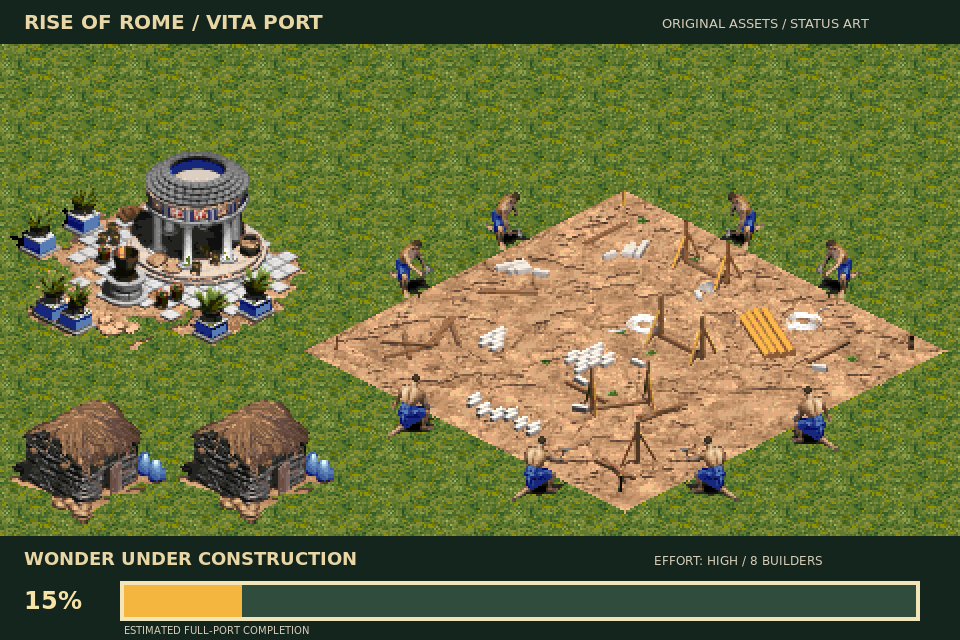

# VitaAgeofEmpires

**A source-backed reconstruction of Age of Empires I for a future native PlayStation Vita port.** Rise of Rome is the primary target; the base game is also supported.

> Research prototype — **not playable yet**. The repository now contains host-side reconstruction libraries, asset/data tools, and a source-backed campaign-scene composition/rendering path, but it does not yet contain an integrated interactive game loop or a playable VPK. A non-playable [Vita tech demo](docs/VITA_DEMO.md) runs the reconstructed runtime and renderer on the console with your own game data.

| | Current state |
|---|---|
| Target | Rise of Rome 1.0a, with base AoE 1.0c retained |
| Implemented | Portable C reconstruction for original data formats, terrain/scenario interpretation, selected world/unit/update/rendering behavior, host-side populated-scene composition, and asset/audio inspection |
| Verified | Host regression suite, optional retail-data audits, source-backed executable analysis, and focused ASan/UBSan parser CI |
| Missing | Complete simulation/gameplay, AI/pathfinding, Vita UI/input/audio playback, save/load, campaign flow, integrated Vita application, playable VPK |

The status illustration below is a reproducible estimate of the **full port**, not a screenshot of running code and not a decompilation-completion metric.

## Start here

- [Build and test](#build-and-test) — get the host regression suite running.
- [Project map](#project-map) — find runtime code, tests, reverse-engineering evidence, and generated exports.
- [Architecture](docs/ARCHITECTURE.md) — understand how the source, tests, binary evidence, and GenieVita boundary fit together.
- [Related projects](docs/RELATED_PROJECTS.md) — clean-room Genie/AoE reconstruction research and boundaries.
- [Documentation guide](docs/README.md) — browse the technical notes by topic.
- [DeepSeek tool audit](docs/DEEPSEEK_TOOL_AUDIT.md) — disposition of the supplied helper code and the corrections integrated from it.
- [Roadmap](TODO.md) — milestones and current blockers.
- [Resume notes](docs/RESUME.md) — detailed handoff for continuing the work.

## Build and test

Requirements: CMake 3.16+, a C11 compiler, zlib development files, and Python 3.

~~~sh
cmake -S . -B build/host -DCMAKE_BUILD_TYPE=Release
cmake --build build/host --parallel
ctest --test-dir build/host --output-on-failure
~~~

The host tests use synthetic fixtures unless optional original game files are present locally. The parser-focused CI path also runs DRS/SLP/DAT/WAV regressions under AddressSanitizer and UndefinedBehaviorSanitizer.

Vita cross-compilation requires [VitaSDK](https://github.com/vitasdk/vita-toolchain); see [Building a Vita update](docs/BUILDING_UPDATE.md). A successful library build does not mean the game boots.

## Project map

| Path | Purpose |
|---|---|
| src/, include/ | Portable C reconstruction components and public interfaces |
| tests/ | Focused host regression tests for reconstructed behavior and binary formats |
| tools/ | Asset/data/audio inspection, campaign-scene tooling, status-art generation, Ghidra audits and exports |
| docs/reversing.md | Detailed behavioral evidence, addresses, and open questions |
| docs/PATCH_REVISIONS.md | Exact patched executable revisions, hashes, and coverage caveats |
| docs/DECOMPILATION_EXPORTS.md | Contents and regeneration of checked-in Ghidra reference exports |
| docs/DEEPSEEK_TOOL_AUDIT.md | Audit of externally generated helper-code proposals and what was accepted/rejected |
| docs/RESUME.md, TODO.md | Handoff notes and project roadmap |
| status/ | Configurable Wonder construction illustration and reproducible recipe |
| build/decompile/ | Checked-in pseudocode/reference exports; not original source code |

### Reverse-engineering status

Patched Ghidra exports currently contain 5,870 discovered functions for AoE 1.0c and 5,850 for Rise of Rome 1.0a, with no decompilation failures among those discovered functions. This is **not complete decompilation**: executable islands, unresolved indirect calls, computed jumps, and function-discovery gaps remain.

### Host-side scene reconstruction

The current host tooling can compose populated scenes from user-supplied original campaign/DAT/DRS data through the reconstructed terrain, object, sprite, palette, and viewport paths. This is an important integration surface, but it is still a **host-side reconstruction/audit path**, not an interactive game and not proof that all simulation or rendering behavior is complete.

### Relationship to GenieVita

This repository is the evidence-first AoE/RoR reconstruction and Vita-port workspace. The separate private [TheGh0stShip/GenieVita](https://github.com/TheGh0stShip/GenieVita) repository is reserved for engine/runtime components that have been validated here as reusable Genie behavior.

~~~text
Age of Empires / Rise of Rome evidence
                 |
                 v
          VitaAgeofEmpires
      decomp + validation + port
                 |
       validated reusable pieces
                 v
             GenieVita
~~~

Do not invent generic engine behavior in GenieVita and force the AoE port to match it. AoE/RoR reconstruction remains the source of truth for what is promoted.

## Game data and legal boundary

Project-authored source code and documentation are licensed under [GPL-3.0-or-later](LICENSE). The license does not grant rights to Age of Empires code or assets; see [LICENSE-NOTICE.md](LICENSE-NOTICE.md).

This repository does not include original game executables, disc images, music, archives, or raw extracted assets. You must obtain and supply any original files yourself.

## Project goal

The long-term goal is a faithful, playable native Vita port, not a diagnostic mock-up. Work should be tied to observed original behavior, carry revision-qualified evidence, and include regression tests.
